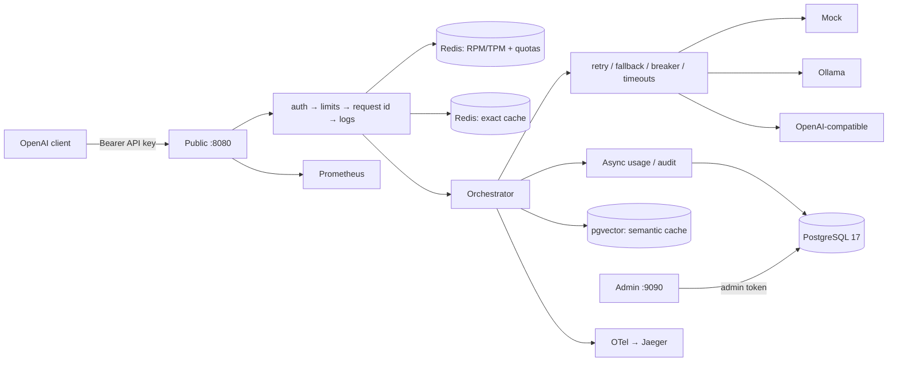

# gogate

[](https://github.com/yugrinovD/gogate/actions/workflows/ci.yml)
[](LICENSE)


**An OpenAI-compatible gateway for LLM providers: local-first, mock by default, Ollama on demand, PostgreSQL and Redis on the hot path.**

**Part of [AI Ops Stack](https://github.com/yugrinovD/ai-ops-stack):**
[gogate](https://github.com/yugrinovD/gogate) ·
[lmlog](https://github.com/yugrinovD/lmlog) ·
[ops-console](https://github.com/yugrinovD/ops-console) ·
[ledger](https://github.com/yugrinovD/ledger) ·
[ai-ops-stack](https://github.com/yugrinovD/ai-ops-stack).

[Русская версия](README.md)

`gogate` exposes a single OpenAI-compatible API (`/v1/chat/completions`,
`/v1/models`) in front of multiple providers: a built-in mock, Ollama and any
OpenAI-compatible upstream. It supports SSE streaming, retries/fallback only
before the first byte, RPM/TPM limits, response caching, token and cost
accounting, usage/audit persistence, Prometheus metrics, OTLP traces and JSON
logs.

The project is designed both for local development and for load: `make demo`
needs no external keys and starts in seconds, while `make load` exercises
500 RPS against the mock provider.

---

## Features

- **OpenAI-compatible public API**: JSON and SSE streaming, `stream_options.include_usage`.
- **Providers**: `mock`, `ollama` (native `/api/chat` → OpenAI SSE), `openai_compatible`.
- **Reliability**: timeouts, retry with jitter, priority fallback, circuit breaker. All of it happens **only before the first byte** of a stream.
- **Keys**: `gk_<env>_<prefix>_<secret>`, SHA-256 + pepper, prefix lookup, plaintext shown once.
- **Limits**: RPM/TPM per key and tenant (Redis Lua token bucket), daily quotas, monthly cost budgets, `429` + `Retry-After`.
- **Caching**: exact Redis cache for non-streaming and optional pgvector semantic cache.
- **Observability**: Prometheus metrics, OTLP traces to Jaeger, JSON logs without prompts/responses or keys.
- **PostgreSQL control plane**: tenants, keys, providers, quotas, prices, usage, audit.
- **P2 features behind flags**: PII redaction, cost budgets, request audit, semantic cache.
- **Docker Compose**: PostgreSQL 17 + pgvector, Redis 7, Prometheus, Grafana, Jaeger, mock upstream, k6 and a standalone-dev `ai` Ollama profile.

---

## Architecture



- **Public listener** (`:8080`) — API and system endpoints.
- **Admin listener** (`:9090`) — separate port, token and router.
- **PostgreSQL** — control plane: keys, providers, quotas, prices, usage, audit, semantic cache.
- **Redis** — hot path: limits, quotas, exact cache.
- **In-memory control-plane snapshot** is refreshed by admin mutations and `POST /admin/v1/reload`; the hot path does not query PostgreSQL for keys or providers.
- **Usage/audit** are written asynchronously in batches to keep them out of response latency.

More: [docs/DESIGN.en.md](docs/DESIGN.en.md) · [Russian](docs/DESIGN.md).

---

## Quick start

Requirements: Docker with Compose v2, `make`, `curl`, `jq` and `openssl`. Ollama is not required for the base demo.

```bash
git clone https://github.com/yugrinovD/gogate.git
cd gogate
make demo
```

`make demo`:

1. Creates `.env` with random local secrets if it does not exist.
2. Starts PostgreSQL, Redis, gogate, Prometheus, Grafana and Jaeger.
3. Creates a demo tenant, API keys and quotas through the admin API.
4. Shows `/v1/models`, a non-streaming response, an SSE stream, a cache hit and a `429` on a 2 RPM key.
5. Prints Grafana/Jaeger/Prometheus URLs and the demo key path.


### Ollama

```bash
make demo-ollama     # starts Ollama, pulls qwen2.5:3b and sends a request
# or just the standalone-dev profile:
make ai-up
make pull-model      # re-pull when the model is already present
```

Ollama uses a separate volume and is optional for `make demo`. If
`GOGATE_OLLAMA_BASE_URL` is set, `qwen2.5:3b` may be visible in `/v1/models`
before Ollama starts; requests work after `make demo-ollama` / `make ai-up`.

`gogate` is the single owner of the LLM integration: providers, timeouts,
retries, fallback, rate limits, cache, metrics and cost live here. `lmlog` and
`ops-console` never talk to Ollama; in the full stack `lmlog` calls `gogate`
over the OpenAI-compatible API.

> The `ai` profile (`llm` is an alias) is for standalone development only. Do
> not run it together with the shared `ai-ops-stack/` stack: two Ollama containers mean
> double RAM usage and a `11434` port conflict.

### Common targets

| Target | Purpose |
| --- | --- |
| `make demo` | mock-only demo + observability stack |
| `make demo-ollama` | demo + Ollama + `qwen2.5:3b` |
| `make ai-up` | standalone-dev Ollama profile + pinned model pull |
| `make pull-model` | pull the pinned model into the running Ollama |
| `make load` | k6: 500 RPS by default, report in `build/k6-summary.json` |
| `make test` / `make test-race` | unit tests |
| `make test-integration` | testcontainers: PostgreSQL + Redis |
| `make bench` | Go benchmarks |
| `make lint` | gofmt, go vet, golangci-lint |
| `make vuln` / `make secrets` | govulncheck / gitleaks |
| `make down` / `make clean` | stop the stack / remove artefacts |

Host ports can be overridden in `.env`: `GOGATE_HTTP_PORT`, `GOGATE_ADMIN_PORT`,
`GOGATE_PROM_PORT`, `GOGATE_GRAFANA_PORT`, `GOGATE_JAEGER_PORT` and others.

---

## API

### Models

```bash
API_KEY=$(cat build/demo-key.txt)

curl -s http://localhost:8080/v1/models \
  -H "Authorization: Bearer $API_KEY" | jq
```

### Non-streaming

```bash
curl -s http://localhost:8080/v1/chat/completions \
  -H "Authorization: Bearer $API_KEY" \
  -H 'Content-Type: application/json' \
  -d '{
    "model": "mock",
    "messages": [{"role": "user", "content": "Hello from gogate"}],
    "temperature": 0.2,
    "max_tokens": 64
  }' | jq
```

Responses include `X-Gogate-Provider` and `X-Gogate-Cache: MISS|HIT|SEMANTIC|BYPASS`.

### Streaming

```bash
curl -N http://localhost:8080/v1/chat/completions \
  -H "Authorization: Bearer $API_KEY" \
  -H 'Content-Type: application/json' \
  -d '{
    "model": "mock",
    "messages": [{"role": "user", "content": "Stream this"}],
    "stream": true,
    "stream_options": {"include_usage": true}
  }'
```

`data: {...}` frames end with `data: [DONE]`.

### Errors

OpenAI-compatible envelope:

```json
{"error":{"message":"limit exceeded: rpm","type":"rate_limit_error","code":"rate_limit_exceeded"}}
```

Main codes: `400`, `401`, `404`, `413`, `429`, `502`, `503`, `504`.

OpenAPI 3.1: [public](api/openapi.public.yaml) · [admin](api/openapi.admin.yaml).
More examples: [docs/API.en.md](docs/API.en.md) · [Russian](docs/API.md).

---

## Configuration

Everything is configured through env. There are no secrets in the repository:
`make init-env` creates `.env` with random values and the file is git-ignored.

| Variable | Default | Description |
| --- | --- | --- |
| `GOGATE_PUBLIC_ADDR` | `:8080` | public listener |
| `GOGATE_ADMIN_ADDR` | `:9090` | admin listener |
| `GOGATE_ADMIN_TOKEN` | — | admin token; empty disables admin |
| `GOGATE_API_KEY_PEPPER` | — | key pepper, required |
| `GOGATE_DATABASE_URL` | local DSN | PostgreSQL |
| `GOGATE_REDIS_ADDR` | `127.0.0.1:6379` | Redis |
| `GOGATE_MAX_OUTPUT_TOKENS` | `4096` | `max_tokens` upper bound |
| `GOGATE_MAX_API_KEY_BYTES` | `256` | maximum API key length before hashing; must exceed the generated key length |
| `GOGATE_CONTROL_RELOAD_INTERVAL` | `30s` | periodic control-plane reload; `0` disables it and leaves pub/sub |
| `GOGATE_UPSTREAM_KEY_PREFIX` | `GOGATE_UPSTREAM_` | allowed `api_key_env` prefix |
| `GOGATE_ALLOW_PRIVATE_UPSTREAMS` | `false` | private/loopback upstream; demo `.env` enables it for Ollama |
| `GOGATE_REQUEST_TIMEOUT` | `120s` | overall request timeout |
| `GOGATE_FIRST_BYTE_TIMEOUT` | `30s` | first-byte timeout |
| `GOGATE_CACHE_ENABLED` | `true` | exact cache |
| `GOGATE_SEMANTIC_CACHE_ENABLED` | `false` | semantic cache (pgvector) |
| `GOGATE_RATE_LIMIT_ENABLED` | `true` | RPM/TPM/quotas |
| `GOGATE_RATE_LIMIT_FAIL_OPEN` | `false` | Redis failure behaviour |
| `GOGATE_PII_REDACT` | `false` | redact email/phone/card in requests |
| `GOGATE_BUDGET_ENABLED` | `true` | monthly cost budgets |
| `GOGATE_AUDIT_ENABLED` | `true` | request metadata audit |
| `GOGATE_TRACING_ENABLED` | `false` | OTLP traces |
| `GOGATE_TRACE_SAMPLE_RATIO` | `1` | trace sampling ratio |
| `OTEL_EXPORTER_OTLP_ENDPOINT` | — | e.g. `http://jaeger:4318` |
| `GOGATE_ACCESS_LOG_SAMPLE` | `1` | access log sampling |
| `GOGATE_CORS_ALLOWED_ORIGINS` | — | explicit Origin allowlist; empty disables CORS |

See [.env.example](.env.example) and [docs/OPERATIONS.en.md](docs/OPERATIONS.en.md).

---

## Admin API

Separate port, separate Bearer token, `/admin/v1` prefix.

- `GET/POST /tenants`
- `GET/POST/PATCH/DELETE /keys` — plaintext returned only on creation
- `GET/POST/PATCH/DELETE /providers`, `POST /providers/{id}/test`
- `GET/POST/DELETE /quotas`
- `GET/POST/DELETE /prices`
- `GET /usage`, `GET /usage/keys` — daily aggregates by tenant/provider/model or by API key
- `GET /audit` — request metadata with `trace_id` and server-side filters
  (`tenant_id`, `model`, `status`, `cache`, `q`, `from`, `to`)
- `POST /cache/purge`
- `GET /health`, `GET /config`, `POST /reload`

Only admins define providers. URLs are validated for scheme/host and
private/metadata addresses; the public API has no user-supplied URLs.

---

## Observability

Metrics (names follow the spec):

`gogate_requests_total`, `gogate_request_duration_seconds`,
`gogate_tokens_total`, `gogate_cost_usd_total`, `gogate_cache_hits_total`,
`gogate_rate_limited_total`, `gogate_upstream_errors_total`,
`gogate_inflight_requests`, `gogate_retries_total`,
`gogate_circuit_breaker_state`, `gogate_usage_dropped_total`,
`gogate_audit_dropped_total`, `gogate_budget_exceeded_total`,
`gogate_pricing_missing_total`.

- Prometheus: `http://localhost:9092`
- Grafana: `http://localhost:3000`, dashboard `gogate — AI gateway`
- Jaeger: `http://localhost:16686`
- `GET /metrics` on the public listener, `GET /admin/v1/health` on admin.

Logs are JSON slog. They include `request_id`, tenant, `key_prefix`, model,
provider, status, latency, tokens, cost and cache. Prompts/responses and API keys
are never logged.

---

## Performance

Methodology and environment: [docs/BENCHMARKS.en.md](docs/BENCHMARKS.en.md) · [Russian](docs/BENCHMARKS.md).

`make load` result (60 seconds, 500 RPS, non-streaming mock, cache bypassed by a
unique prompt in every request):

| Metric | Value |
| --- | --- |
| Requests | 30,001 |
| RPS | 500.0 |
| Errors | 0% |
| p50 | 0.44 ms |
| p95 | 0.54 ms |
| p99 | 0.75 ms |
| max | 56.8 ms |
| Baseline mock upstream p99 | 0.21 ms |
| p99 overhead | ≈ 0.54 ms |
| gogate RSS under load | ≈ 60 MiB |

Hardware: 16 vCPU, 31 GiB RAM, Debian 13, Docker 29.10. Results depend on the
host; these are real measurements, not estimates.

---

## Tests and CI

- Unit tests: keys, auth, providers, SSE/NDJSON parsers, retry/fallback, breaker,
  PII, cache keys, usage merge, DTO validation.
- Integration (`-tags=integration`): testcontainers with `pgvector/pgvector:pg17`
  and `redis:7-alpine`; full auth → limits → cache → provider → usage/audit path,
  streaming, fallback, 429, PII, semantic cache.
- `go test -race ./...`.
- CI: gofmt, vet, golangci-lint, unit + integration, govulncheck, gitleaks,
  OpenAPI lint, Docker build + Trivy.
- Dependabot for Go, GitHub Actions and Docker.

---

## Layout

```text
cmd/gogate/                 # public + admin listeners
cmd/gogate-mockupstream/    # OpenAI-compatible mock upstream for baselines
internal/httpapi/           # public API and SSE
internal/adminapi/          # admin API
internal/orchestrator/      # retry/fallback/breaker/first-byte boundary
internal/provider/          # mock, ollama, openai-compatible, registry
internal/ratelimit/         # Redis Lua: RPM/TPM, quotas, budgets
internal/cache/             # exact Redis cache + pgvector semantic cache
internal/store/             # pgx, migrations, usage/audit
internal/usage/             # async batched writer
internal/observability/     # Prometheus + OTel
internal/security/          # keys and SSRF validation
api/                        # OpenAPI 3.1 (English)
deploy/                     # Prometheus, Grafana, Jaeger configs
k6/                         # load scenarios
tests/integration/          # testcontainers
docs/                       # RU/EN documentation and ADRs
```

---

## Limitations

- gogate does not terminate TLS; use a reverse proxy.
- Text chat only. Tools/function calling, images, audio and embeddings are not part
  of the public API scope (embeddings are only used by the semantic cache).
- Semantic cache requires pgvector and an embedder; the mock embedder is allowed
  only for demo/tests, production uses an Ollama/OpenAI-compatible embedder.
  The cache accounts for generation parameters and a fixed 768 dimension.
- Redis Cluster is not a goal: Lua scripts assume a single Redis (keys use a hash
  tag for future compatibility, but dynamic keys in a cluster need a different scheme).
- Streaming responses are not PII-redacted (to preserve first-byte latency);
  requests are always redacted when enabled, and the PII mode is part of the cache key.
- Usage/audit are asynchronous: there may be a small lag; if queues overflow,
  records are dropped and the drop is visible in metrics.
- Budgets are soft at settlement: the reservation uses `prompt + max_tokens`, then
  is corrected by actual usage.
- Limit and budget counters live in Redis; losing Redis resets them (configuration
  and usage remain in PostgreSQL).
- With multiple replicas, key revocation propagates via periodic reload
  (`GOGATE_CONTROL_RELOAD_INTERVAL`) or Redis pub/sub, with a window up to the interval.
- `GOGATE_REQUEST_TIMEOUT` also bounds long streams; increase it for very long generations.
- Multi-region, Kubernetes and billing are non-goals.

## Security

- Admin is a separate port with a separate token and constant-time comparison.
- API keys are stored as SHA-256(pepper || secret); plaintext is never stored or logged.
- Body limit, message/token limits, timeouts, CORS disabled by default.
- SSRF defence: only admins set provider URLs; scheme, userinfo, metadata/link-local
  and private addresses are validated (private addresses need an explicit flag for
  local Ollama; the flag defaults to false).
- `api_key_env` is restricted to the `GOGATE_UPSTREAM_` prefix so an admin cannot
  read an arbitrary process secret and send it to an upstream.
- pprof only on admin and only behind a flag.
- Secrets are env-only; `.env` is generated locally and git-ignored.

More: [docs/THREAT_MODEL.en.md](docs/THREAT_MODEL.en.md) · [Russian](docs/THREAT_MODEL.md).

## ADRs

- [0001 Provider abstraction](docs/adr/0001-provider-abstraction.en.md) · [RU](docs/adr/0001-provider-abstraction.md)
- [0002 PostgreSQL control plane / Redis hot path](docs/adr/0002-control-plane-hot-path.en.md) · [RU](docs/adr/0002-control-plane-hot-path.md)
- [0003 API keys](docs/adr/0003-api-keys.en.md) · [RU](docs/adr/0003-api-keys.md)
- [0004 Rate limiting](docs/adr/0004-rate-limiting.en.md) · [RU](docs/adr/0004-rate-limiting.md)
- [0005 First-byte boundary](docs/adr/0005-first-byte-boundary.en.md) · [RU](docs/adr/0005-first-byte-boundary.md)
- [0006 Cache tiers](docs/adr/0006-cache-tiers.en.md) · [RU](docs/adr/0006-cache-tiers.md)
- [0007 Async usage and cost](docs/adr/0007-async-usage.en.md) · [RU](docs/adr/0007-async-usage.md)
- [0008 Admin isolation and SSRF](docs/adr/0008-admin-isolation-ssrf.en.md) · [RU](docs/adr/0008-admin-isolation-ssrf.md)

## License

MIT. See [LICENSE](LICENSE).
