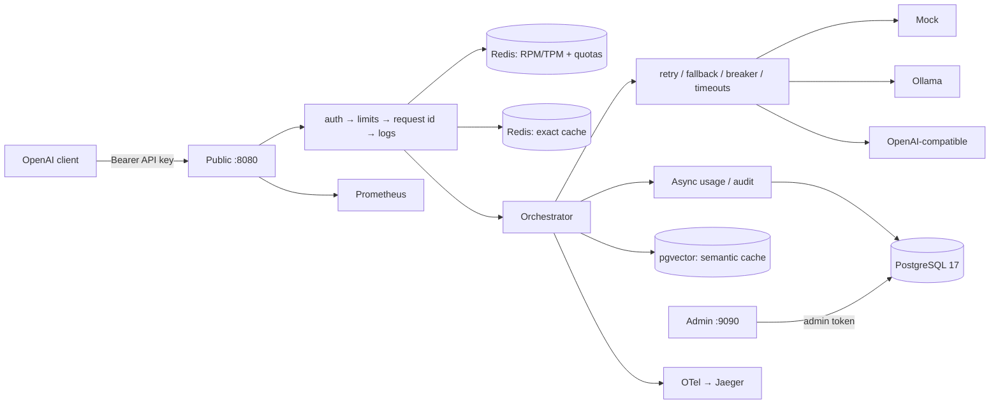

# gogate

[](https://github.com/yugrinovD/gogate/actions/workflows/ci.yml)
[](LICENSE)
[](https://github.com/yugrinovD/gogate/releases)


**An OpenAI-compatible gateway for LLM providers: local-first, mock by default,
Ollama on demand, PostgreSQL and Redis on the hot path.**

**Part of [AI Ops Stack](https://github.com/yugrinovD/ai-ops-stack):**
[gogate](https://github.com/yugrinovD/gogate) ·
[lmlog](https://github.com/yugrinovD/lmlog) ·
[ops-console](https://github.com/yugrinovD/ops-console) ·
[ledger](https://github.com/yugrinovD/ledger) ·
[ai-ops-stack](https://github.com/yugrinovD/ai-ops-stack).

[Русская версия](README.md) · [Changelog](CHANGELOG.md)

I built it around a local Ollama first, mostly because I did not want upstream
keys in tests. Mock, limits and fallback came later — once you can simulate a
dead provider, testing becomes much less exciting.

Today `gogate` exposes one OpenAI-compatible API in front of mock, Ollama and any
OpenAI-compatible upstream. It does SSE, retries/fallback before the first byte,
RPM/TPM, caching, token and cost accounting, usage/audit and metrics.

## Features

- **Public API**: `/v1/chat/completions` and `/v1/models`, JSON and SSE,
  `stream_options.include_usage`.
- **Providers**: `mock`, `ollama` (native `/api/chat` → OpenAI SSE),
  `openai_compatible`.
- **Reliability**: timeouts, retry with jitter, priority fallback, circuit
  breaker. All of it only before the first byte of a stream.
- **Keys and limits**: `gk_<env>_<prefix>_<secret>`, SHA-256 + pepper, RPM/TPM
  per key and tenant, daily quotas, monthly cost budgets.
- **Caching**: exact Redis cache for non-streaming and an optional pgvector
  semantic cache.
- **Observability**: Prometheus, OTLP traces, JSON logs without prompts,
  responses or keys.
- **PostgreSQL control plane**: tenants, keys, providers, quotas, prices, usage
  and audit.

## Architecture



Public listener on `:8080`, admin on `:9090` with its own token. PostgreSQL is
the control plane; Redis holds limits, quotas and the exact cache. The hot path
does not query PostgreSQL for keys — it keeps an in-memory snapshot and updates it
on admin mutations or a periodic reload.

More: [docs/DESIGN.en.md](docs/DESIGN.en.md).

## Quick start

You need Docker Compose v2, `make`, `curl`, `jq` and `openssl`. Ollama is not
required for the basic demo.

```bash
git clone https://github.com/yugrinovD/gogate.git
cd gogate
make demo
```

`make demo` creates `.env` with random local secrets, starts PostgreSQL, Redis,
gogate, Prometheus, Grafana and Jaeger, creates a demo tenant and keys, then shows
a non-streaming response, SSE, a cache hit and a `429` on a key limited to 2 RPM.


Ollama is a separate profile:

```bash
make demo-ollama     # Ollama + qwen2.5:3b + one request
make ai-up           # standalone-dev profile only
make pull-model      # pull again
```

`gogate` is the only owner of the LLM integration. `lmlog` and `ops-console` do
not talk to Ollama; in the full stack `lmlog` calls `gogate` over the
OpenAI-compatible API.

> The `ai` profile is for standalone development only. Do not run it together
> with `ai-ops-stack/`: two Ollama containers mean double RAM and a port conflict
> on `11434`.

### Commands

| Command | What it does |
| --- | --- |
| `make demo` | mock-only demo + infrastructure |
| `make demo-ollama` | demo + Ollama + `qwen2.5:3b` |
| `make load` | k6, 500 RPS by default, report in `build/k6-summary.json` |
| `make test` / `make test-race` | unit tests |
| `make test-integration` | testcontainers: PostgreSQL + Redis |
| `make bench` | Go benchmarks |
| `make lint` | gofmt, go vet, golangci-lint |
| `make down` / `make clean` | stop the stack / remove artifacts |

Host ports can be overridden in `.env`: `GOGATE_HTTP_PORT`,
`GOGATE_ADMIN_PORT`, `GOGATE_PROM_PORT`, `GOGATE_GRAFANA_PORT`,
`GOGATE_JAEGER_PORT`.

## API

```bash
API_KEY=$(cat build/demo-key.txt)

curl -s http://localhost:8080/v1/chat/completions \
  -H "Authorization: Bearer $API_KEY" \
  -H 'Content-Type: application/json' \
  -d '{
    "model": "mock",
    "messages": [{"role": "user", "content": "Hello from gogate"}],
    "temperature": 0.2,
    "max_tokens": 64
  }' | jq
```

The response includes `X-Gogate-Provider` and
`X-Gogate-Cache: MISS|HIT|SEMANTIC|BYPASS`.

Streaming is the same endpoint with `"stream": true`. `data: {...}` frames end
with `data: [DONE]`. Errors use the OpenAI-compatible envelope:
`{"error":{"message":"...","type":"rate_limit_error","code":"rate_limit_exceeded"}}`.

OpenAPI 3.1: [public](api/openapi.public.yaml) ·
[admin](api/openapi.admin.yaml). More examples:
[docs/API.en.md](docs/API.en.md).

## Configuration

Everything is env-driven. `make init-env` creates `.env` with random values; the
file is git-ignored.

| Variable | Default | Why |
| --- | --- | --- |
| `GOGATE_PUBLIC_ADDR` | `:8080` | public listener |
| `GOGATE_ADMIN_ADDR` | `:9090` | admin listener |
| `GOGATE_ADMIN_TOKEN` | — | admin API token |
| `GOGATE_API_KEY_PEPPER` | — | pepper for SHA-256 keys |
| `GOGATE_DATABASE_URL` | local DSN | PostgreSQL |
| `GOGATE_REDIS_ADDR` | `127.0.0.1:6379` | Redis |
| `GOGATE_MAX_OUTPUT_TOKENS` | `4096` | upper bound for `max_tokens` |
| `GOGATE_ALLOW_PRIVATE_UPSTREAMS` | `false` | private/loopback upstream; enabled for Ollama in demo |
| `GOGATE_CACHE_ENABLED` | `true` | exact cache |
| `GOGATE_RATE_LIMIT_ENABLED` | `true` | RPM/TPM and quotas |
| `GOGATE_TRACING_ENABLED` | `false` | OTLP traces |

The rest is in [.env.example](.env.example) and
[docs/OPERATIONS.en.md](docs/OPERATIONS.en.md).

## Admin and observability

Admin API lives on a separate port with a separate bearer token: tenants, keys,
providers, quotas, prices, usage, audit, cache purge, health and reload. Full
list: [admin OpenAPI](api/openapi.admin.yaml).

Metrics: `gogate_requests_total`, `gogate_request_duration_seconds`,
`gogate_tokens_total`, `gogate_cost_usd_total`, `gogate_cache_hits_total`,
`gogate_rate_limited_total`, `gogate_upstream_errors_total`,
`gogate_inflight_requests`. Logs are JSON slog with `request_id`, tenant, model,
provider, status, latency, tokens, cost and cache. Prompts, responses and keys
are not logged.

## Performance

`make load`: 60 seconds, 500 RPS, non-streaming mock, cache bypassed with a unique
prompt per request.

| Metric | Value |
| --- | ---: |
| Requests | 30,001 |
| RPS | 500.0 |
| Errors | 0% |
| p50 / p95 / p99 | 0.44 / 0.54 / 0.75 ms |
| Baseline mock upstream, p99 | 0.21 ms |
| p99 overhead | ~0.54 ms |
| RSS under load | ~60 MiB |

Hardware: 16 vCPU, 31 GiB RAM, Debian 13, Docker 29.10. Numbers depend on the
host; this is a real local run. Method:
[docs/BENCHMARKS.en.md](docs/BENCHMARKS.en.md).

## Limitations

- TLS is not terminated here; put a reverse proxy in front.
- Text chat only. Tools/function calling, images, audio and embeddings are not
  part of the public API yet.
- Semantic cache needs pgvector and an embedder; the mock embedder is for
  demos/tests only.
- Redis Cluster is not a goal: the Lua scripts assume a single Redis.
- Streaming responses skip PII redaction to keep first-byte latency. Requests are
  redacted when the flag is on.
- Usage/audit are asynchronous: a small lag is possible, and dropped writes show
  up in metrics.
- Multi-region, Kubernetes and billing are non-goals.

## Security

- Admin is a separate port, a separate token and a constant-time comparison.
- API keys are stored as `SHA-256(pepper || secret)`; plaintext is never stored
  or logged.
- Body limits, message/token limits, timeouts, CORS off by default.
- SSRF protection: only admins set provider URLs; scheme, userinfo,
  metadata/link-local and private addresses are checked.

More: [docs/THREAT_MODEL.en.md](docs/THREAT_MODEL.en.md).

## Docs

- [DESIGN.en.md](docs/DESIGN.en.md) — architecture and trade-offs
- [API.en.md](docs/API.en.md) — request examples
- [OPERATIONS.en.md](docs/OPERATIONS.en.md) — running and troubleshooting
- [BENCHMARKS.en.md](docs/BENCHMARKS.en.md) — method and numbers
- [THREAT_MODEL.en.md](docs/THREAT_MODEL.en.md) — threats and mitigations

ADRs: [provider abstraction](docs/adr/0001-provider-abstraction.en.md),
[control plane](docs/adr/0002-control-plane-hot-path.en.md),
[first-byte boundary](docs/adr/0005-first-byte-boundary.en.md),
[admin isolation](docs/adr/0008-admin-isolation-ssrf.en.md). The rest are in
[docs/adr](docs/adr).

## License

MIT. See [LICENSE](LICENSE).
