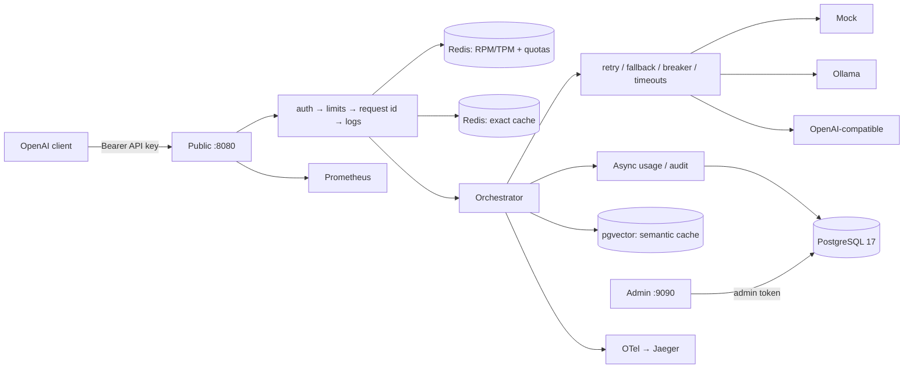

# gogate

[](https://github.com/yugrinovD/gogate/actions/workflows/ci.yml)
[](LICENSE)
[](https://github.com/yugrinovD/gogate/releases)


**OpenAI-совместимый шлюз к LLM-провайдерам: локальный запуск, mock из коробки, Ollama по требованию, PostgreSQL и Redis на горячем пути.**

**Part of [AI Ops Stack](https://github.com/yugrinovD/ai-ops-stack):**
[gogate](https://github.com/yugrinovD/gogate) ·
[lmlog](https://github.com/yugrinovD/lmlog) ·
[ops-console](https://github.com/yugrinovD/ops-console) ·
[ledger](https://github.com/yugrinovD/ledger) ·
[ai-ops-stack](https://github.com/yugrinovD/ai-ops-stack).

[English version](README.en.md) · [Changelog](CHANGELOG.md)

`gogate` предоставляет единый OpenAI-совместимый API (`/v1/chat/completions`,
`/v1/models`) поверх разных провайдеров: встроенного mock, Ollama и любого
OpenAI-compatible upstream. Шлюз умеет стримить SSE, делать retry/fallback
только до первого байта, ограничивать RPM/TPM, кэшировать ответы, считать
токены и стоимость, писать usage/audit и отдавать метрики, трейсы и JSON-логи.

Проект рассчитан на локальную разработку и на нагрузку: `make demo` не требует
внешних ключей и запускается за секунды, а `make load` проверяет 500 RPS на
mock-провайдере.

---

## Возможности

- **OpenAI-совместимый публичный API**: JSON и SSE streaming, `stream_options.include_usage`.
- **Провайдеры**: `mock`, `ollama` (native `/api/chat` → OpenAI SSE), `openai_compatible`.
- **Надёжность**: таймауты, retry с jitter, fallback по priority, circuit breaker. Всё это работает **только до первого байта** стрима.
- **Ключи**: формат `gk_<env>_<prefix>_<secret>`, SHA-256 + pepper, поиск по префиксу, plaintext показывается один раз.
- **Лимиты**: RPM/TPM на ключ и тенанта (Redis Lua, token bucket), дневные квоты, месячные cost budgets, `429` + `Retry-After`.
- **Кэш**: точный Redis-кэш для non-streaming и опциональный semantic cache на pgvector.
- **Наблюдаемость**: Prometheus-метрики, OTLP-трейсы в Jaeger, JSON-логи без prompt/response и без ключей.
- **Control plane в PostgreSQL**: тенанты, ключи, провайдеры, квоты, цены, usage, audit.
- **P2-фичи под флагами**: PII-redaction, cost budgets, audit запросов, semantic cache.
- **Docker Compose**: PostgreSQL 17 + pgvector, Redis 7, Prometheus, Grafana, Jaeger, mock-upstream, k6 и standalone-dev профиль `ai` с Ollama.

---

## Архитектура



- **Public listener** (`:8080`) — API и системные endpoint'ы.
- **Admin listener** (`:9090`) — отдельный порт, отдельный токен, отдельный роутер.
- **PostgreSQL** — control plane: ключи, провайдеры, квоты, цены, usage, audit, semantic cache.
- **Redis** — горячий путь: лимиты, квоты, exact cache.
- **In-memory snapshot** control plane обновляется при admin-мутациях и по `POST /admin/v1/reload`; hot path не ходит в PostgreSQL за ключами и провайдерами.
- **Usage/audit** пишутся асинхронными батчами, чтобы не добавлять latency в ответ.

Подробнее: [docs/DESIGN.md](docs/DESIGN.md) · [English](docs/DESIGN.en.md).

---

## Быстрый старт

Требования: Docker с Compose v2, `make`, `curl`, `jq` и `openssl`. Ollama не требуется для базового demo.

```bash
git clone https://github.com/yugrinovD/gogate.git
cd gogate
make demo
```

Что делает `make demo`:

1. Генерирует `.env` со случайными локальными секретами, если его ещё нет.
2. Поднимает PostgreSQL, Redis, gogate, Prometheus, Grafana и Jaeger.
3. Создаёт demo-тенанта, API-ключи и квоты через admin API.
4. Показывает `/v1/models`, non-streaming ответ, SSE-стрим, попадание в кэш и `429` на ключе с лимитом 2 RPM.
5. Печатает URL-ы Grafana/Jaeger/Prometheus и путь к demo-ключу.


### Ollama

```bash
make demo-ollama     # поднимет Ollama, скачает qwen2.5:3b и сделает запрос
# или только standalone-dev профиль:
make ai-up
make pull-model      # повторный pull, если модель уже есть
```

Ollama использует отдельный volume и не обязателен для `make demo`. Если
`GOGATE_OLLAMA_BASE_URL` задан, модель `qwen2.5:3b` может быть видна в
`/v1/models` до запуска Ollama; запросы к ней начнут работать после
`make demo-ollama` / `make ai-up`.

`gogate` — единственный владелец LLM-интеграции: провайдеры, таймауты, retry,
fallback, rate limit, кэш, метрики и стоимость живут здесь. `lmlog` и
`ops-console` не ходят в Ollama; в полном стеке `lmlog` вызывает `gogate` по
OpenAI-совместимому API.

> Профиль `ai` (`llm` — алиас) предназначен только для standalone-разработки.
> Не запускайте его одновременно с общим стеком `ai-ops-stack/`: два Ollama-контейнера
> дают двойной расход RAM и конфликт порта `11434`.

### Полезные команды

| Команда | Назначение |
| --- | --- |
| `make demo` | mock-only demo + инфраструктура |
| `make demo-ollama` | demo + Ollama + `qwen2.5:3b` |
| `make ai-up` | standalone-dev Ollama profile + pinned model pull |
| `make pull-model` | pull the pinned model into the running Ollama |
| `make load` | k6: 500 RPS по умолчанию, отчёт в `build/k6-summary.json` |
| `make test` / `make test-race` | unit-тесты |
| `make test-integration` | testcontainers: PostgreSQL + Redis |
| `make bench` | Go-бенчмарки |
| `make lint` | gofmt, go vet, golangci-lint |
| `make vuln` / `make secrets` | govulncheck / gitleaks |
| `make down` / `make clean` | остановка стека / удаление артефактов |

Host-порты можно переопределить в `.env`: `GOGATE_HTTP_PORT`, `GOGATE_ADMIN_PORT`,
`GOGATE_PROM_PORT`, `GOGATE_GRAFANA_PORT`, `GOGATE_JAEGER_PORT` и другие. В
локальном `docker-compose.yml` все host-порты привязаны к `127.0.0.1`.

---

## API

### Модели

```bash
API_KEY=$(cat build/demo-key.txt)

curl -s http://localhost:8080/v1/models \
  -H "Authorization: Bearer $API_KEY" | jq
```

### Non-streaming

```bash
curl -s http://localhost:8080/v1/chat/completions \
  -H "Authorization: Bearer $API_KEY" \
  -H 'Content-Type: application/json' \
  -d '{
    "model": "mock",
    "messages": [{"role": "user", "content": "Hello from gogate"}],
    "temperature": 0.2,
    "max_tokens": 64
  }' | jq
```

Ответ содержит `X-Gogate-Provider` и `X-Gogate-Cache: MISS|HIT|SEMANTIC|BYPASS`.

### Streaming

```bash
curl -N http://localhost:8080/v1/chat/completions \
  -H "Authorization: Bearer $API_KEY" \
  -H 'Content-Type: application/json' \
  -d '{
    "model": "mock",
    "messages": [{"role": "user", "content": "Stream this"}],
    "stream": true,
    "stream_options": {"include_usage": true}
  }'
```

`data: {...}` фреймы завершаются `data: [DONE]`.

### Ошибки

OpenAI-совместимый envelope:

```json
{"error":{"message":"limit exceeded: rpm","type":"rate_limit_error","code":"rate_limit_exceeded"}}
```

Основные коды: `400`, `401`, `404`, `413`, `429`, `502`, `503`, `504`.

OpenAPI 3.1 (English): [public](api/openapi.public.yaml) · [admin](api/openapi.admin.yaml).
Подробные примеры: [docs/API.md](docs/API.md) · [English](docs/API.en.md).

---

## Конфигурация

Все настройки — через env. Секретов в репозитории нет: `make init-env` создаёт
`.env` со случайными значениями, файл исключён из git.

| Переменная | По умолчанию | Описание |
| --- | --- | --- |
| `GOGATE_PUBLIC_ADDR` | `:8080` | публичный listener |
| `GOGATE_ADMIN_ADDR` | `:9090` | admin listener |
| `GOGATE_ADMIN_TOKEN` | — | токен admin API; пустой отключает admin |
| `GOGATE_API_KEY_PEPPER` | — | pepper для SHA-256 ключей, обязателен |
| `GOGATE_DATABASE_URL` | local DSN | PostgreSQL |
| `GOGATE_REDIS_ADDR` | `127.0.0.1:6379` | Redis |
| `GOGATE_MAX_OUTPUT_TOKENS` | `4096` | верхняя граница `max_tokens` |
| `GOGATE_MAX_API_KEY_BYTES` | `256` | максимум длины API-ключа до хэширования; не меньше длины сгенерированного ключа |
| `GOGATE_CONTROL_RELOAD_INTERVAL` | `30s` | периодический reload control plane; `0` отключает, остаётся pub/sub |
| `GOGATE_UPSTREAM_KEY_PREFIX` | `GOGATE_UPSTREAM_` | разрешённый префикс `api_key_env` |
| `GOGATE_ALLOW_PRIVATE_UPSTREAMS` | `false` | private/loopback upstream; в demo-`.env` включён для Ollama |
| `GOGATE_REQUEST_TIMEOUT` | `120s` | общий таймаут запроса |
| `GOGATE_FIRST_BYTE_TIMEOUT` | `30s` | таймаут до первого байта |
| `GOGATE_CACHE_ENABLED` | `true` | exact cache |
| `GOGATE_SEMANTIC_CACHE_ENABLED` | `false` | semantic cache (pgvector) |
| `GOGATE_RATE_LIMIT_ENABLED` | `true` | RPM/TPM/квоты |
| `GOGATE_RATE_LIMIT_FAIL_OPEN` | `false` | поведение при недоступности Redis |
| `GOGATE_PII_REDACT` | `false` | redaction email/phone/card в запросах |
| `GOGATE_BUDGET_ENABLED` | `true` | месячные cost budgets |
| `GOGATE_AUDIT_ENABLED` | `true` | audit метаданных запросов |
| `GOGATE_TRACING_ENABLED` | `false` | OTLP-трейсы |
| `GOGATE_TRACE_SAMPLE_RATIO` | `1` | sampling трейсов |
| `OTEL_EXPORTER_OTLP_ENDPOINT` | — | например `http://jaeger:4318` |
| `GOGATE_ACCESS_LOG_SAMPLE` | `1` | sampling access-логов |
| `GOGATE_CORS_ALLOWED_ORIGINS` | — | явный allowlist Origin; пусто = CORS выключен |

Полный список — в [.env.example](.env.example) и
[docs/OPERATIONS.md](docs/OPERATIONS.md).

---

## Admin API

Отдельный порт, отдельный Bearer-токен, префикс `/admin/v1`.

- `GET/POST /tenants`
- `GET/POST/PATCH/DELETE /keys` — plaintext ключа возвращается только при создании
- `GET/POST/PATCH/DELETE /providers`, `POST /providers/{id}/test`
- `GET/POST/DELETE /quotas`
- `GET/POST/DELETE /prices`
- `GET /usage`, `GET /usage/keys` — daily aggregates by tenant/provider/model or by API key
- `GET /audit` — request metadata, including `trace_id` and server-side filters
  (`tenant_id`, `model`, `status`, `cache`, `q`, `from`, `to`)
- `POST /cache/purge`
- `GET /health`, `GET /config`, `POST /reload`

Провайдеры задаёт только админ. URL проверяется на scheme/host и private/metadata
адреса; user-supplied URL в публичном API отсутствуют.

---

## Наблюдаемость

Метрики (имена по ТЗ):

`gogate_requests_total`, `gogate_request_duration_seconds`,
`gogate_tokens_total`, `gogate_cost_usd_total`, `gogate_cache_hits_total`,
`gogate_rate_limited_total`, `gogate_upstream_errors_total`,
`gogate_inflight_requests`, `gogate_retries_total`,
`gogate_circuit_breaker_state`, `gogate_usage_dropped_total`,
`gogate_audit_dropped_total`, `gogate_budget_exceeded_total`,
`gogate_pricing_missing_total`.

- Prometheus: `http://localhost:9092`
- Grafana: `http://localhost:3000`, dashboard `gogate — AI gateway`
- Jaeger: `http://localhost:16686`
- `GET /metrics` на public listener, `GET /admin/v1/health` — на admin.

Логи — JSON slog. В них есть `request_id`, tenant, `key_prefix`, model, provider,
status, latency, tokens, cost, cache. Prompt/response и API-ключи не логируются.

---

## Производительность

Методика и окружение: [docs/BENCHMARKS.md](docs/BENCHMARKS.md) · [English](docs/BENCHMARKS.en.md).

Результат `make load` (60 секунд, 500 RPS, non-streaming mock, кэш обходится
уникальным prompt в каждом запросе):

| Метрика | Значение |
| --- | --- |
| Запросов | 30 001 |
| RPS | 500.0 |
| Ошибки | 0% |
| p50 | 0.44 ms |
| p95 | 0.54 ms |
| p99 | 0.75 ms |
| max | 56.8 ms |
| Baseline mock-upstream, p99 | 0.21 ms |
| Overhead p99 | ≈ 0.54 ms |
| RSS gogate под нагрузкой | ≈ 60 MiB |

Железо: 16 vCPU, 31 GiB RAM, Debian 13, Docker 29.10. Цифры зависят от хоста;
это реальный прогон, а не теоретическая оценка.

---

## Тесты и CI

- Unit-тесты: ключи, auth, провайдеры, SSE/NDJSON-парсеры, retry/fallback,
  breaker, PII, cache key, usage merge, DTO-валидация.
- Integration (`-tags=integration`): testcontainers с `pgvector/pgvector:pg17`
  и `redis:7-alpine`; полный путь auth → limits → cache → provider → usage/audit,
  стриминг, fallback, 429, PII, semantic cache.
- `go test -race ./...`.
- CI: gofmt, vet, golangci-lint, unit + integration, govulncheck, gitleaks,
  OpenAPI lint, Docker build + Trivy.
- Dependabot для Go, GitHub Actions и Docker.

---

## Структура

```text
cmd/gogate/                 # public + admin listeners
cmd/gogate-mockupstream/    # OpenAI-compatible mock upstream для baseline
internal/httpapi/           # публичный API и SSE
internal/adminapi/          # admin API
internal/orchestrator/      # retry/fallback/breaker/first-byte boundary
internal/provider/          # mock, ollama, openai-compatible, registry
internal/ratelimit/         # Redis Lua: RPM/TPM, квоты, бюджеты
internal/cache/             # exact Redis cache + pgvector semantic cache
internal/store/             # pgx, миграции, usage/audit
internal/usage/             # async batched writer
internal/observability/     # Prometheus + OTel
internal/security/          # ключи и SSRF-валидация
api/                        # OpenAPI 3.1 (English)
deploy/                     # Prometheus, Grafana, Jaeger configs
k6/                         # нагрузочные сценарии
tests/integration/          # testcontainers
docs/                       # RU/EN документация и ADR
```

---

## Ограничения

- TLS не терминируется самим gogate; используйте reverse proxy.
- Поддерживается текстовый chat. Tools/function calling, изображения, аудио и
  embeddings как публичный API не входят в текущий scope (embeddings
  используются только внутри semantic cache).
- Semantic cache требует pgvector и embedder; mock-embedder разрешён только для
  demo/тестов, в production используется Ollama/OpenAI-compatible embedder.
  Кэш учитывает параметры генерации и фиксированную размерность 768.
- Redis Cluster не является целью: Lua-скрипты рассчитаны на один Redis
  (ключи используют hash tag на будущее, но динамические ключи в cluster
  требуют отдельной схемы).
- Streaming-ответы не проходят PII-redaction (чтобы не ломать first-byte latency);
  запросы редактируются всегда при включённом флаге, PII-режим входит в ключ кэша.
- Usage/audit асинхронные: возможен небольшой лаг; при переполнении очередей
  записи дропаются и это видно в метриках.
- Budgets мягкие на settlement: резерв считается по `prompt + max_tokens`,
  затем корректируется фактическим usage.
- Счётчики лимитов и бюджетов живут в Redis; потеря Redis сбрасывает их
  (конфигурация и usage в PostgreSQL при этом сохраняются).
- При нескольких репликах отзыв ключа доезжает через периодический reload
  (`GOGATE_CONTROL_RELOAD_INTERVAL`) или Redis pub/sub; окно — до интервала.
- `GOGATE_REQUEST_TIMEOUT` ограничивает и длинные стримы; для очень долгих
  генераций увеличьте его.
- Multi-region, Kubernetes и биллинг — non-goals.

## Безопасность

- Admin — отдельный порт, отдельный токен, constant-time сравнение.
- API-ключи хранятся как SHA-256(pepper || secret), plaintext не сохраняется и
  не логируется.
- Body limit, лимиты сообщений/токенов, таймауты, CORS выключен по умолчанию.
- SSRF-защита: URL провайдеров задаёт только админ; проверяются scheme, userinfo,
  metadata/link-local, private-адреса (private разрешены только флагом для
  локального Ollama; по умолчанию флаг выключен).
- `api_key_env` ограничен префиксом `GOGATE_UPSTREAM_`, чтобы admin не мог
  прочитать произвольный секрет процесса и отправить его на upstream.
- pprof — только на admin и только по флагу.
- Секреты — только env; `.env` генерируется локально и исключён из git.

Подробнее: [docs/THREAT_MODEL.md](docs/THREAT_MODEL.md) · [English](docs/THREAT_MODEL.en.md).

## ADR

- [0001 Provider abstraction](docs/adr/0001-provider-abstraction.md) · [EN](docs/adr/0001-provider-abstraction.en.md)
- [0002 PostgreSQL control plane / Redis hot path](docs/adr/0002-control-plane-hot-path.md) · [EN](docs/adr/0002-control-plane-hot-path.en.md)
- [0003 API keys](docs/adr/0003-api-keys.md) · [EN](docs/adr/0003-api-keys.en.md)
- [0004 Rate limiting](docs/adr/0004-rate-limiting.md) · [EN](docs/adr/0004-rate-limiting.en.md)
- [0005 First-byte boundary](docs/adr/0005-first-byte-boundary.md) · [EN](docs/adr/0005-first-byte-boundary.en.md)
- [0006 Cache tiers](docs/adr/0006-cache-tiers.md) · [EN](docs/adr/0006-cache-tiers.en.md)
- [0007 Async usage and cost](docs/adr/0007-async-usage.md) · [EN](docs/adr/0007-async-usage.en.md)
- [0008 Admin isolation and SSRF](docs/adr/0008-admin-isolation-ssrf.md) · [EN](docs/adr/0008-admin-isolation-ssrf.en.md)

## Лицензия

MIT. См. [LICENSE](LICENSE).
