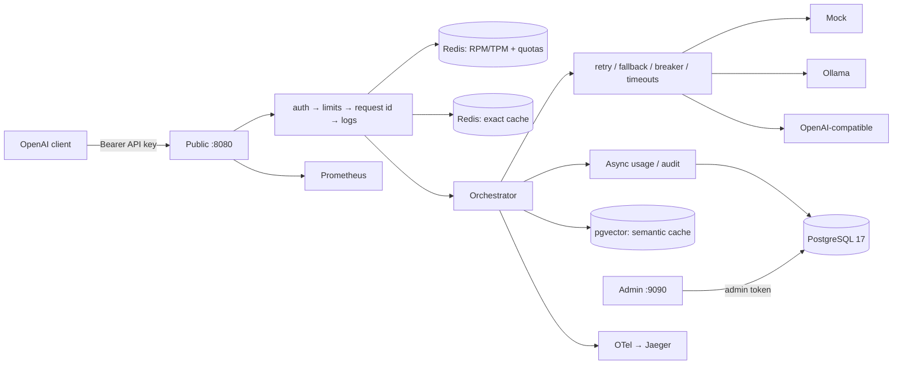

# gogate

[](https://github.com/yugrinovD/gogate/actions/workflows/ci.yml)
[](LICENSE)
[](https://github.com/yugrinovD/gogate/releases)


**OpenAI-совместимый шлюз к LLM-провайдерам: локальный запуск, mock из коробки,
Ollama по требованию, PostgreSQL и Redis на горячем пути.**

**Part of [AI Ops Stack](https://github.com/yugrinovD/ai-ops-stack):**
[gogate](https://github.com/yugrinovD/gogate) ·
[lmlog](https://github.com/yugrinovD/lmlog) ·
[ops-console](https://github.com/yugrinovD/ops-console) ·
[ledger](https://github.com/yugrinovD/ledger) ·
[ai-ops-stack](https://github.com/yugrinovD/ai-ops-stack).

[English version](README.en.md) · [Changelog](CHANGELOG.md)

Сначала сделал его под локальный Ollama, потому что не хотелось тащить внешние
ключи в тесты. Потом добавились mock, лимиты и fallback — так удобнее проверять,
что будет, когда провайдер лёг.

Сейчас `gogate` даёт один OpenAI-совместимый API поверх mock, Ollama и любого
OpenAI-compatible upstream. Умеет SSE, retry/fallback только до первого байта,
RPM/TPM, кэш, учёт токенов и стоимости, usage/audit и метрики.

## Что умеет

- **Публичный API**: `/v1/chat/completions` и `/v1/models`, JSON и SSE,
  `stream_options.include_usage`.
- **Провайдеры**: `mock`, `ollama` (native `/api/chat` → OpenAI SSE),
  `openai_compatible`.
- **Надёжность**: таймауты, retry с jitter, fallback по priority, circuit
  breaker. Всё это работает только до первого байта стрима.
- **Ключи и лимиты**: `gk_<env>_<prefix>_<secret>`, SHA-256 + pepper, RPM/TPM
  на ключ и тенанта, дневные квоты, месячные cost budgets.
- **Кэш**: точный Redis-кэш для non-streaming и опциональный semantic cache на
  pgvector.
- **Наблюдаемость**: Prometheus, OTLP-трейсы, JSON-логи без prompt/response и
  без ключей.
- **Control plane в PostgreSQL**: тенанты, ключи, провайдеры, квоты, цены,
  usage и audit.

## Архитектура



- Публичный listener на `:8080`, admin — на `:9090` с отдельным токеном.
- PostgreSQL — control plane, Redis — лимиты, квоты и exact cache.
- Hot path не ходит в PostgreSQL за ключами: держит in-memory snapshot и
  обновляет его по admin-мутациям или периодическому reload.

Подробнее: [docs/DESIGN.md](docs/DESIGN.md).

## Быстрый старт

Нужны Docker Compose v2, `make`, `curl`, `jq` и `openssl`. Ollama для базового
демо не нужна.

```bash
git clone https://github.com/yugrinovD/gogate.git
cd gogate
make demo
```

`make demo` создаёт `.env` со случайными секретами, поднимает PostgreSQL,
Redis, gogate, Prometheus, Grafana и Jaeger, заводит demo-тенанта и ключи,
показывает non-streaming ответ, SSE, кэш и `429` на ключе с лимитом 2 RPM.


Ollama поднимается отдельно:

```bash
make demo-ollama     # Ollama + qwen2.5:3b + запрос
make ai-up           # только standalone-dev профиль
make pull-model      # повторить pull
```

`gogate` — единственный владелец LLM-интеграции. `lmlog` и `ops-console` не
ходят в Ollama; в полном стеке `lmlog` вызывает `gogate` по
OpenAI-совместимому API.

> Профиль `ai` нужен только для standalone-разработки. Не запускайте его
> одновременно с `ai-ops-stack/`: два Ollama-контейнера дают двойной расход RAM
> и конфликт порта `11434`.

### Команды

| Команда | Что делает |
| --- | --- |
| `make demo` | mock-only demo + инфраструктура |
| `make demo-ollama` | demo + Ollama + `qwen2.5:3b` |
| `make load` | k6, 500 RPS по умолчанию, отчёт в `build/k6-summary.json` |
| `make test` / `make test-race` | unit-тесты |
| `make test-integration` | testcontainers: PostgreSQL + Redis |
| `make bench` | Go-бенчмарки |
| `make lint` | gofmt, go vet, golangci-lint |
| `make down` / `make clean` | остановить стек / удалить артефакты |

Порты можно переопределить в `.env`: `GOGATE_HTTP_PORT`, `GOGATE_ADMIN_PORT`,
`GOGATE_PROM_PORT`, `GOGATE_GRAFANA_PORT`, `GOGATE_JAEGER_PORT`.

## API

```bash
API_KEY=$(cat build/demo-key.txt)

curl -s http://localhost:8080/v1/chat/completions \
  -H "Authorization: Bearer $API_KEY" \
  -H 'Content-Type: application/json' \
  -d '{
    "model": "mock",
    "messages": [{"role": "user", "content": "Hello from gogate"}],
    "temperature": 0.2,
    "max_tokens": 64
  }' | jq
```

Ответ содержит `X-Gogate-Provider` и `X-Gogate-Cache: MISS|HIT|SEMANTIC|BYPASS`.

Стрим — тот же endpoint с `"stream": true`. Фреймы `data: {...}` заканчиваются
`data: [DONE]`. Ошибки приходят в OpenAI-совместимом envelope:
`{"error":{"message":"...","type":"rate_limit_error","code":"rate_limit_exceeded"}}`.

OpenAPI 3.1: [public](api/openapi.public.yaml) · [admin](api/openapi.admin.yaml).
Примеры и коды: [docs/API.md](docs/API.md).

## Конфигурация

Всё через env. `make init-env` создаёт `.env` со случайными значениями, файл
исключён из git.

| Переменная | По умолчанию | Зачем |
| --- | --- | --- |
| `GOGATE_PUBLIC_ADDR` | `:8080` | публичный listener |
| `GOGATE_ADMIN_ADDR` | `:9090` | admin listener |
| `GOGATE_ADMIN_TOKEN` | — | токен admin API |
| `GOGATE_API_KEY_PEPPER` | — | pepper для SHA-256 ключей |
| `GOGATE_DATABASE_URL` | local DSN | PostgreSQL |
| `GOGATE_REDIS_ADDR` | `127.0.0.1:6379` | Redis |
| `GOGATE_MAX_OUTPUT_TOKENS` | `4096` | верхняя граница `max_tokens` |
| `GOGATE_ALLOW_PRIVATE_UPSTREAMS` | `false` | private/loopback upstream; в demo включён для Ollama |
| `GOGATE_CACHE_ENABLED` | `true` | exact cache |
| `GOGATE_RATE_LIMIT_ENABLED` | `true` | RPM/TPM и квоты |
| `GOGATE_TRACING_ENABLED` | `false` | OTLP-трейсы |

Остальное — в [.env.example](.env.example) и
[docs/OPERATIONS.md](docs/OPERATIONS.md).

## Admin и наблюдаемость

Admin API живёт на отдельном порту с отдельным Bearer-токеном: тенанты, ключи,
провайдеры, квоты, цены, usage, audit, purge кэша, health и reload. Полный
список — в [admin OpenAPI](api/openapi.admin.yaml).

Метрики: `gogate_requests_total`, `gogate_request_duration_seconds`,
`gogate_tokens_total`, `gogate_cost_usd_total`, `gogate_cache_hits_total`,
`gogate_rate_limited_total`, `gogate_upstream_errors_total`,
`gogate_inflight_requests`. Логи — JSON slog с `request_id`, tenant, model,
provider, status, latency, tokens, cost и cache. Prompt/response и ключи не
логируются.

## Производительность

`make load`: 60 секунд, 500 RPS, non-streaming mock, кэш обходится уникальным
prompt в каждом запросе.

| Метрика | Значение |
| --- | ---: |
| Запросов | 30 001 |
| RPS | 500.0 |
| Ошибки | 0% |
| p50 / p95 / p99 | 0.44 / 0.54 / 0.75 ms |
| Baseline mock-upstream, p99 | 0.21 ms |
| Overhead p99 | ~0.54 ms |
| RSS под нагрузкой | ~60 MiB |

Железо: 16 vCPU, 31 GiB RAM, Debian 13, Docker 29.10. Цифры зависят от хоста;
это реальный локальный прогон. Методика — в
[docs/BENCHMARKS.md](docs/BENCHMARKS.md).

## Ограничения

- TLS не терминируется: нужен reverse proxy.
- Поддерживается текстовый chat. Tools/function calling, изображения, аудио и
  embeddings как публичный API не входят в текущий scope.
- Semantic cache требует pgvector и embedder; mock-embedder — только для
  demo/тестов.
- Redis Cluster не является целью: Lua-скрипты рассчитаны на один Redis.
- Streaming-ответы не проходят PII-redaction, чтобы не ломать first-byte
  latency. Запросы редактируются всегда при включённом флаге.
- Usage/audit асинхронные: возможен небольшой лаг, при переполнении очередей
  записи дропаются и это видно в метриках.
- Multi-region, Kubernetes и биллинг — non-goals.

## Безопасность

- Admin — отдельный порт, отдельный токен, constant-time сравнение.
- API-ключи хранятся как `SHA-256(pepper || secret)`, plaintext не сохраняется
  и не логируется.
- Body limit, лимиты сообщений/токенов, таймауты, CORS выключен по умолчанию.
- SSRF-защита: URL провайдеров задаёт только админ; проверяются scheme,
  userinfo, metadata/link-local и private-адреса.

Подробнее: [docs/THREAT_MODEL.md](docs/THREAT_MODEL.md).

## Документация

- [DESIGN.md](docs/DESIGN.md) — архитектура и trade-offs
- [API.md](docs/API.md) — примеры запросов
- [OPERATIONS.md](docs/OPERATIONS.md) — запуск и troubleshooting
- [BENCHMARKS.md](docs/BENCHMARKS.md) — методика и цифры
- [THREAT_MODEL.md](docs/THREAT_MODEL.md) — угрозы и меры

ADR: [provider abstraction](docs/adr/0001-provider-abstraction.md),
[control plane](docs/adr/0002-control-plane-hot-path.md),
[first-byte boundary](docs/adr/0005-first-byte-boundary.md),
[admin isolation](docs/adr/0008-admin-isolation-ssrf.md). Остальные — в
[docs/adr](docs/adr).

## Лицензия

MIT. См. [LICENSE](LICENSE).
